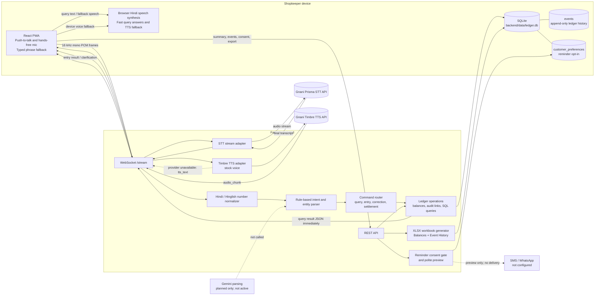
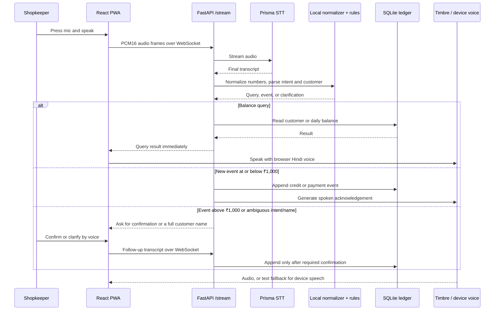

# Voice Khata system architecture

This diagram describes the implementation that is currently in the repository. The Gemini fallback from the original concept is **not wired into the live path**.

## System view

## Voice entry path

## Ledger and guardrails

- Credits, payments, corrections, and settlements are stored as ledger events. A correction appends a replacement event linked to the event it corrects; it does not overwrite the original.
- A payment reduces the customer's balance. When a full-repayment command is recognized, the backend records a payment for the outstanding balance. Zero-balance customers are omitted from the active balance view; event history remains.
- Ordinary entries up to ₹1,000 are committed without a confirmation prompt. Larger entries require confirmation. Ambiguous customer prefixes retain the draft until the shopkeeper chooses a full name.
- Balance queries use local SQL and do not call Gemini. Browser speech synthesis speaks query results immediately when available; Timbre is used for other spoken output, with a device voice fallback.
- Reminder preferences are stored per customer. The backend can prepare a fixed, polite message only after opt-in and only when a balance is owed. It does not send SMS or WhatsApp messages because no delivery provider is configured.
- The workbook export is generated locally from balances and the full event history. `Open in Excel` uses the desktop `ms-excel:` protocol when installed; `Download Excel` is the browser fallback.
- SQLite is local-first and the backend is started on `127.0.0.1`. A remote deployment needs authentication and encrypted storage.

## Interfaces

| Interface | Purpose |
| --- | --- |
| `WS /stream` | Audio in, transcripts, clarifications, ledger results, and spoken response audio out |
| `GET /ledger/summary` | Active customer balances and per-day totals |
| `GET /ledger/events` | Recent ledger event history |
| `GET /ledger/export.xlsx` | Excel workbook with `Balances` and `Event History` sheets |
| `POST /parse` | Inspect a transcript with the local rule parser |
| `POST /ledger/apply` | Apply explicit ledger events or parsed transcript data |
| `GET/PUT /customers/{customer_name}/reminder-consent` | Read or update reminder opt-in state |
| `POST /reminders/prepare` | Prepare a polite reminder preview after consent; no message is sent |
| `POST /tts` | Request Timbre audio for text |

## Current limits

Prisma recognition quality depends on its model, the microphone, and shop noise. Its current transcript event does not provide a numeric confidence score, so automatic confidence scoring is unavailable on that provider path. There is no active Gemini fallback, messaging delivery service, remote authentication, or encrypted remote database configuration.
